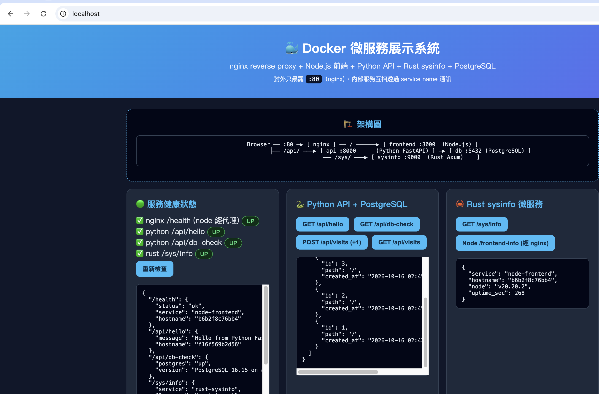
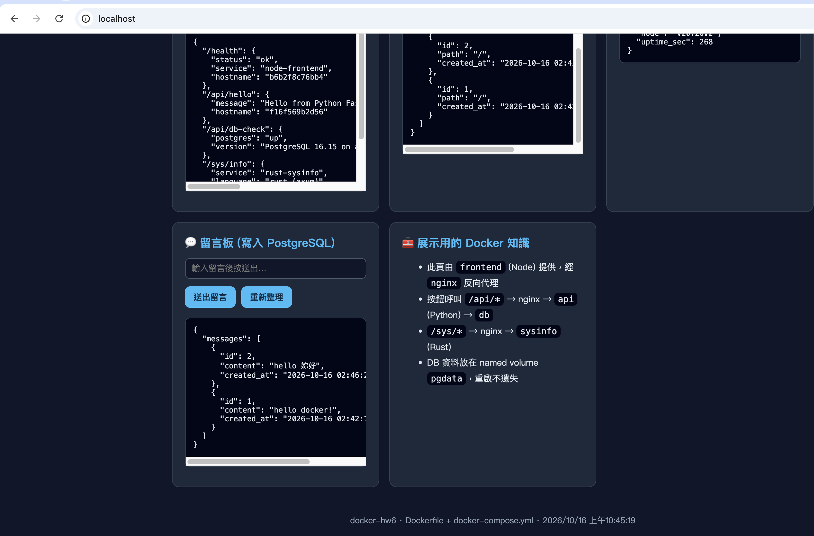

# Docker 微服務展示系統（docker-hw6）

> 作業要求：學會使用 Docker 並做記錄（本文件），用 Docker 建置一個系統，
> 繳交內容包含 `Dockerfile` 和 `docker-compose.yml`，
> 內含 nginx（reverse proxy）、PostgreSQL、開發執行環境（Node.js / Python / Rust），
> 以及一個簡易 Web 介面展示整個系統。

## 1. 系統架構

```
Browser ── :80 ─▶ [ nginx ] ── / ──────────▶ [ frontend :3000 (Node.js Express) ]
                       ├── /api/* ────▶ [ api :8000 (Python FastAPI) ] ─▶ [ db :5432 (PostgreSQL) ]
                       └── /sys/* ────▶ [ sysinfo :9000 (Rust Axum) ]
```

| 容器 | 技術 | 角色 | 對外 |
|------|------|------|------|
| `nginx` | nginx:1.27-alpine | 唯一對外窗口，reverse proxy | `80:80` |
| `frontend` | node:20-alpine + Express | Web 展示介面（靜態頁 + `/health`、`/frontend-info`） | 內網 `:3000` |
| `api` | python:3.12-slim + FastAPI | 業務 API，讀寫 PostgreSQL（visits、messages） | 內網 `:8000` |
| `sysinfo` | Rust + Axum（multi-stage build） | 第三個微服務，回傳 hostname / OS / uptime | 內網 `:9000` |
| `db` | postgres:16-alpine | 資料庫，資料持久化在 named volume `pgdata` | 內網 `:5432` |

Web 介面（經 nginx）：`http://localhost/`，可一鍵測試各服務健康狀態、
Python API、Rust 微服務、留言板（寫入 PostgreSQL）。

## 2. 專案結構

```
.
├── README.md               # 本文件（Docker 學習記錄）
├── docker-compose.yml      # 全系統編排（5 個服務 + volume + network）
├── backend/                # Python API
│   ├── Dockerfile
│   ├── app.py
│   └── requirements.txt
├── frontend/               # Node.js 前端
│   ├── Dockerfile
│   ├── package.json
│   ├── server.js
│   └── public/index.html   # 展示用 Web 介面
├── rust-sysinfo/           # Rust 微服務
│   ├── Dockerfile          # multi-stage build
│   ├── Cargo.toml
│   └── src/main.rs
└── nginx/
    ├── Dockerfile
    └── nginx.conf          # reverse proxy 路由規則
```

## 3. 快速開始

前置需求：Docker Desktop（已含 Docker Compose v2）。

```bash
# 1. 建置全部 image
docker compose build

# 2. 啟動全系統（背景執行）
docker compose up -d

# 3. 查看狀態（db、api 應為 healthy）
docker compose ps

# 4. 開啟 Web 介面
open http://localhost/
```

常用驗證指令：

```bash
curl http://localhost/health           # Node 前端（經 nginx）
curl http://localhost/api/hello        # Python API
curl http://localhost/api/db-check     # Python → PostgreSQL 連線檢查
curl -X POST http://localhost/api/visits  # visits +1
curl http://localhost/sys/info         # Rust 微服務
curl http://localhost/frontend-info    # Node 資訊

# 留言板（寫入 PostgreSQL）
curl -X POST http://localhost/api/messages \
  -H 'Content-Type: application/json' -d '{"content":"hello docker!"}'
curl http://localhost/api/messages
```

關閉 / 清理：

```bash
docker compose down        # 停止並刪除容器、網路（保留 pgdata 資料）
docker compose down -v     # 連同資料庫資料一起刪除（注意！）
docker compose logs -f api # 看某服務 log
```

## 4. Docker 學習記錄

### 4.1 核心概念

- **Image（映像檔）**：唯讀模板，由 `Dockerfile` 一層一層（layer）建出來。
  `docker images` 可看到每個 image 的大小與層級。
- **Container（容器）**：image 的執行個體，彼此隔離。
  本專案 `docker compose ps` 會看到 5 個容器各跑一個行程。
- **Dockerfile**：`FROM → WORKDIR → COPY → RUN → EXPOSE → CMD`。
  `RUN` 是建置期執行（裝套件、編譯），`CMD` 是容器啟動時執行。
- **Volume**：容器檔案系統預設是暫時的；`pgdata:/var/lib/postgresql/data`
  把資料庫檔案掛到 named volume，重建容器資料還在。
- **Network**：compose 自動建一個 bridge 網路 `appnet`，
  服務之間直接用 service name 當 hostname（例如 Python 連 `db:5432`），
  只有 nginx 需要 `ports: "80:80"` 對外。
- **Reverse proxy**：瀏覽器只打 `:80`，nginx 依路徑分流
  （`/`→frontend、` health`→frontend、`/api/`→api、`/sys/`→sysinfo），
  後端服務不直接暴露，見 `nginx/nginx.conf`。

### 4.2 Dockerfile 寫法重點（本專案實例）

- **Python（backend/Dockerfile）**：`python:3.12-slim` 為基底，
  先 `COPY requirements.txt` 再 `pip install`，可利用 layer cache
  （依賴沒變就不重裝）；`CMD ["uvicorn", "app:app", ...]`，
  注意 `--host 0.0.0.0`，否則容器外連不進來。
- **Node（frontend/Dockerfile）**：`node:20-alpine` 輕量基底，
  `npm install --omit=dev` 不裝 dev 依賴；靜態頁放在 `public/`。
- **Rust（rust-sysinfo/Dockerfile）**：multi-stage build。
  第一階段用 `rust:bookworm` 編譯出 binary，
  第二階段只拿 `debian:bookworm-slim` + binary 當執行環境，
  image 從 ~1GB 壓到 ~139MB。
- **Nginx（nginx/Dockerfile）**：`nginx:1.27-alpine` + 覆蓋
  `/etc/nginx/conf.d/default.conf`，只有兩行。

### 4.3 docker-compose.yml 寫法重點

- `build: ./xxx` 各服務用自己的 Dockerfile；`db` 直接用官方 image。
- `depends_on` + `condition: service_healthy` 保證啟動順序
  （db 先 healthy → api 才啟動；api healthy → nginx 才啟動）。
- `healthcheck`：db 用 `pg_isready`，api 用 python urllib 打自己的 `/health`。
- `expose` 只在內網開 port；`ports` 才對外。本專案只有 nginx 有 `ports`。
- 環境變數：`DATABASE_URL=postgresql://demo:demo123@db:5432/demo`，
  注意 host 寫 `db`（service name），不是 `localhost`。

### 4.4 學到的常用指令

```bash
docker --version && docker compose version
docker compose build [service]        # 建置（--no-cache 強制重建）
docker compose up -d                  # 背景啟動
docker compose ps                     # 狀態
docker compose logs -f [service]      # 追 log（除錯用）
docker compose exec db psql -U demo   # 進資料庫手動查表
docker images / docker ps             # image / 容器一覽
docker run --rm -p 19000:9000    # 單獨測試某個 image
```

### 4.5 實作中踩到的三個坑

1. **Rust 編譯失敗 `edition2024 is required`**：
   最初用 `rust:1.82`，但新版 `hyper-util` 需要 edition2024（Cargo 1.85+）。
   解法：builder 改用 `rust:bookworm`（最新 stable）。
2. **假 main 快取陷阱**：Dockerfile 曾用「先建假 `main.rs` 快取依賴」技巧，
   但 dummy 沒有依賴、快取無效，且第二次 `cargo build` 被層快取騙過（0.02s 結束），
  產出的是秒退的空 binary。解法：刪掉該技巧，直接 `COPY` 全碼編譯。
3. **Python 建表少一張 + lifespan 沒掛上**：
   (a) `psycopg3` 的 `execute()` 一次只跑一個 statement，
   兩個 `CREATE TABLE` 寫在同一字串只有第一個生效 → 拆成逐句執行；
   (b) 寫了 `lifespan` 卻忘了 `FastAPI(lifespan=lifespan)`，建表從沒跑過 →
   掛上後重建即正常。教訓：500 錯誤先看 `docker compose logs api`。

## 5. 作業要求對照

| 要求 | 落實位置 |
|------|----------|
| README 學習記錄 | 本文件 §4 |
| Dockerfile | `backend/`、`frontend/`、`rust-sysinfo/`、`nginx/` 各一 |
| docker-compose.yml | 根目錄（5 services + pgdata + appnet） |
| nginx reverse proxy | `nginx/nginx.conf`，唯一 `:80` 出口 |
| PostgreSQL | `db` service + `pgdata` volume |
| Node.js / Python / Rust | frontend(Node) / api(Python) / sysinfo(Rust) 三種執行環境皆有 |
| 簡易 Web 介面 | `frontend/public/index.html`，`http://localhost/` |

## 6. 未來可延伸

- 加上 HTTPS（nginx 掛 certbot 或自簽憑證）。
- API 加上單元測試與 CI（GitHub Actions 建置 + `compose up` 煙霧測試）。
- Rust 改用 `cargo-chef` 做更正確的依賴層快取。
- 加上 Prometheus + Grafana 監控容器狀態。


## 執行結果截圖




## 問題： 假如 frontend/ 需要開很多個 容器來平行服務，需要什麼修改嗎？

## 7. 附錄：frontend 開多個容器平行服務

### 7.1 frontend 本身幾乎不用改

它用的是 `expose` 而非 `ports`，開 N 個也不會搶 host port；
`server.js` 也是無狀態的（靜態檔 + `/health`、`/frontend-info`，
回傳的 `hostname` 不同正好可用來驗證負載分散）。啟動方式：

```bash
docker compose up -d --scale frontend=3
docker compose ps   # 看到 3 個 frontend
```

### 7.2 必改：`nginx/nginx.conf`

原本 `upstream { server frontend:3000; }` 在 nginx 啟動時只解析一次，
直接 `--scale` 的話流量不會真正分散到新副本（甚至該容器掛掉會 502）。
要讓 nginx 每次請求都重新問 Docker 內建 DNS（`127.0.0.11`）：

```nginx
resolver 127.0.0.11 valid=10s ipv6=off;
set $frontend_upstream frontend;

server {
    listen 80;
    location / {
        proxy_pass http://$frontend_upstream:3000;  # 經由變數才會每次重解析
        ...
    }
    location = /health {
        proxy_pass http://$frontend_upstream:3000/health;
    }
    location = /frontend-info {
        proxy_pass http://$frontend_upstream:3000/frontend-info;
    }
    ...
}
```

原理：`proxy_pass` 後面接變數時，nginx 會在每個 request 時重新做 DNS 查詢，
而 Docker DNS 對一個 service name 會輪流回傳多個 replica 的 IP，
達到 round-robin 分散。

### 7.3 選配：給 frontend 加 `healthcheck`

方便 `docker compose ps` 看出哪個副本異常（`docker-compose.yml`）：

```yaml
frontend:
  healthcheck:
    test: ["CMD", "node", "-e", "fetch('http://localhost:3000/health').then(r=>{if(!r.ok)process.exit(1)})"]
    interval: 10s
    retries: 3
```

### 7.4 驗證

```bash
docker compose build nginx && docker compose up -d --scale frontend=3
for i in $(seq 1 6); do curl -s http://localhost/frontend-info | grep hostname; done
# 應看到 3 種不同 hostname 輪流出現
```

注意：如果以後前端有了本機狀態（session、記憶體快取），
多副本還要考慮 sticky session（`ip_hash`，但與上面的變數式寫法互斥）
或把狀態外移到 redis/db；目前這個純靜態前端沒有此問題。
